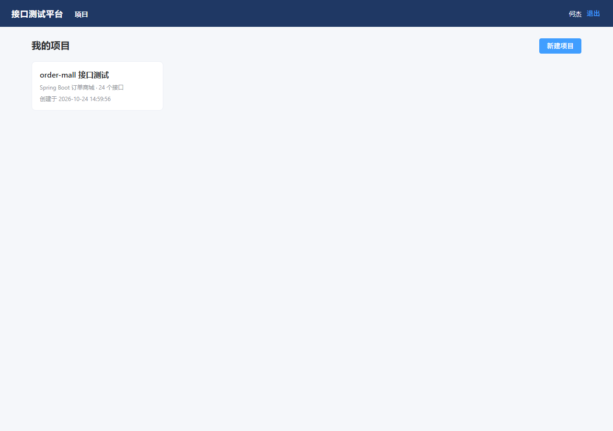
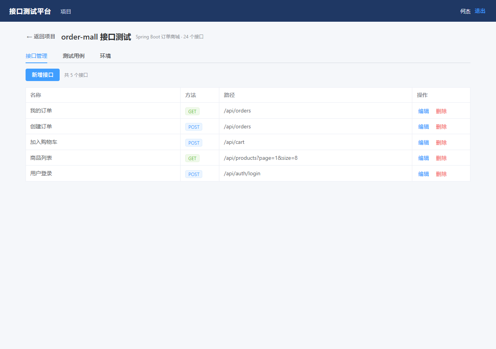
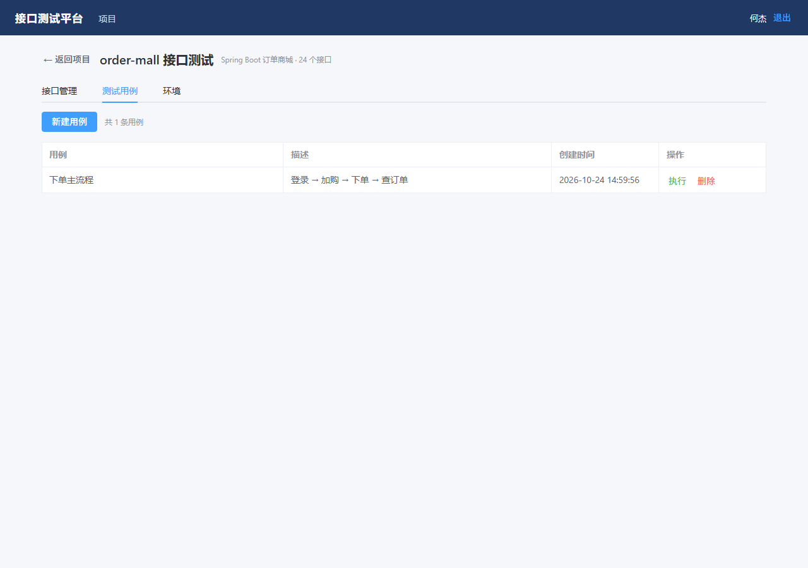
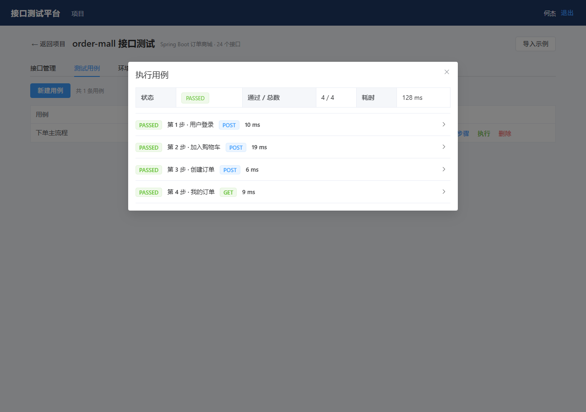
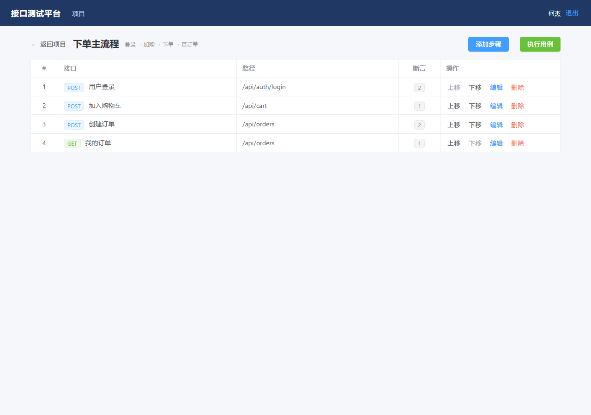

# test-platform · 接口自动化测试平台

把命令行里的 pytest 框架，升级成「网页配接口、编用例、一键执行、看报告」的平台。
被测对象直接用 `order-mall`，形成「我写服务 → 我写平台测它」的闭环。

> 状态：M1–M4 完成。后端 30+ 类、前端 4 个页面、一键导入示例、接口文档齐全，已用 order-mall 端到端跑通。

## 技术栈

后端：Spring Boot 3.2.5 · JDK 17 · JdbcTemplate · MySQL 8 · JDK HttpClient · 线程池异步执行
前端：Vue 3 · Vite · Element Plus · Axios · Vue Router

## 页面预览

| 项目列表 | 接口管理 |
|---|---|
|  |  |

| 用例列表 | 执行报告（4 步全过） |
|---|---|
|  |  |

| 用例编辑（步骤编排） |
|---|
|  |

## 目录结构

```
test-platform/
├── backend/
│   ├── pom.xml
│   └── src/main/
│       ├── java/com/example/testplatform/
│       │   ├── common/      ApiResponse / BizException / GlobalExceptionHandler / PageResult / PasswordUtil
│       │   ├── config/      AuthInterceptor / WebConfig / DataInitializer
│       │   ├── controller/  Auth / Health / Project / Env / Api / Case / Step / Run
│       │   ├── service/     User / Token / Project / Env / Api / Case / Step / **Runner**
│       │   ├── dao/         UserDao / ProjectDao / EnvDao / ApiDao / CaseDao / StepDao / RunDao
│       │   ├── model/       User / Project / Env / Api / TestCase / TestStep / Run / RunDetail
│       │   └── dto/         请求与展示对象
│       └── resources/       application.yml / schema.sql
├── frontend/
│   ├── vite.config.js       5174 端口，/api 代理到 18092
│   └── src/views/           Login / Projects / ProjectDetail
└── docs/                    设计文档 + 截图
```

## 启动

### 后端

```powershell
cd B:\dshWork\02-测试项目\test-platform\backend
mvn -DskipTests package
java '-Dfile.encoding=UTF-8' -jar target\test-platform.jar
```

### 前端

```powershell
cd B:\dshWork\02-测试项目\test-platform\frontend
npm install
npm run dev          # http://localhost:5174
```

- 端口：`18092`
- 健康检查：`http://127.0.0.1:18092/api/health`
- 数据库：`test_platform`（自动创建，8 张表见 `schema.sql`）
- 默认管理员：`admin / admin123`

## 已实现接口（M1）

| 方法 | 路径 | 说明 |
|---|---|---|
| GET | `/api/health` | 健康检查 |
| POST | `/api/auth/register` | 注册（username / password / nickname） |
| POST | `/api/auth/login` | 登录 |
| GET | `/api/auth/me` | 当前用户 |
| POST | `/api/auth/logout` | 登出 |
| GET | `/api/projects` | 我的项目（ADMIN 看全部） |
| POST | `/api/projects` | 新建项目 |
| GET | `/api/projects/{id}` | 项目详情 |
| PUT | `/api/projects/{id}` | 修改项目 |
| DELETE | `/api/projects/{id}` | 删除项目（级联清理环境/接口/用例/记录） |
| GET | `/api/projects/{pid}/envs` | 环境列表 |
| POST | `/api/projects/{pid}/envs` | 新建环境（base_url 必须 http(s)） |
| PUT | `/api/envs/{id}` | 修改环境 |
| DELETE | `/api/envs/{id}` | 删除环境 |
| GET | `/api/projects/{pid}/apis` | 接口列表 |
| POST | `/api/projects/{pid}/apis` | 新建接口 |
| PUT | `/api/apis/{id}` | 修改接口 |
| DELETE | `/api/apis/{id}` | 删除接口（被步骤引用时 409） |
| GET | `/api/projects/{pid}/cases` | 用例列表 |
| POST | `/api/projects/{pid}/cases` | 新建用例 |
| GET | `/api/cases/{id}` | 用例详情 |
| PUT | `/api/cases/{id}` | 修改用例 |
| DELETE | `/api/cases/{id}` | 删除用例（连带步骤） |
| GET | `/api/cases/{cid}/steps` | 步骤列表（带接口名/方法/路径） |
| POST | `/api/cases/{cid}/steps` | 新增步骤（sort 自增） |
| PUT | `/api/steps/{id}` | 修改步骤 |
| DELETE | `/api/steps/{id}` | 删除步骤 |
| POST | `/api/cases/{cid}/run` | **异步执行**，立即返回 `RUNNING` 的 run | 是 |
| GET | `/api/runs/{id}` | 执行详情（轮询用，含每步快照） | 是 |
| GET | `/api/projects/{pid}/runs` | 项目执行记录列表 | 是 |
| POST | `/api/projects/{pid}/seed-demo` | **一键导入示例**（5 接口 + 1 用例 + 4 步骤 + 环境） | 是 |

鉴权：`Authorization: Bearer <token>`；普通用户只能访问自己的项目，越权返回 403。

## 数据表（8 张，已全部建好）

`sys_user`、`project`、`env`、`api`、`test_case`、`test_step`、`run`、`run_detail`

后四张表 M2/M3 才会用到，先建好避免后面改库。

## 执行引擎（M2 核心）

```
用例步骤（按 sort）
  → 变量池（初始为空）
  → 每步：渲染 ${var} → 发请求 → 存快照 → 提取变量 → 跑断言
  → 断言失败：默认中断；continue_on_fail=true 则跑完
  → 汇总落库：run + run_detail
```

**断言类型**

| type | 参数 | 说明 |
|---|---|---|
| `status` | `expect` | HTTP 状态码等于 |
| `json` | `path`, `expect` | 按 `$.a.b[0].c` 取值比较 |
| `contain` | `text` | 响应体包含文本 |
| `time` | `max_ms` | 响应耗时上限 |

**变量提取**：`[{"name":"token","path":"$.data.token"}]`，后续步骤用 `${token}` 引用。

## 开发进度

- [x] M1 骨架 + 建表 + 登录 + 项目/环境管理
- [x] M2 接口管理 + 用例与步骤 + 执行引擎（同步）
- [x] M3 异步执行 + 报告 + 前端（登录 / 项目 / 接口 / 用例 / 报告）
- [x] M4 用例编辑页 + 一键导入示例 + 文档
